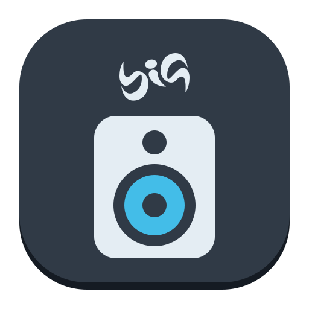
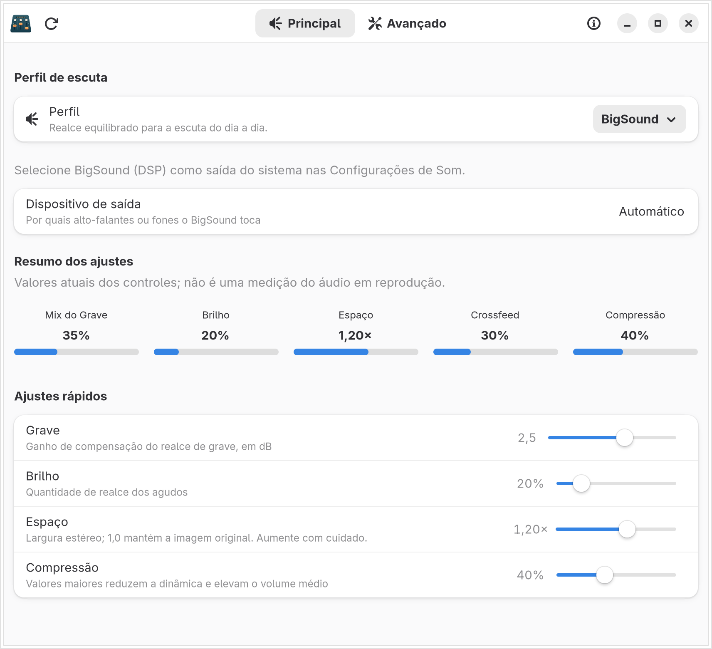
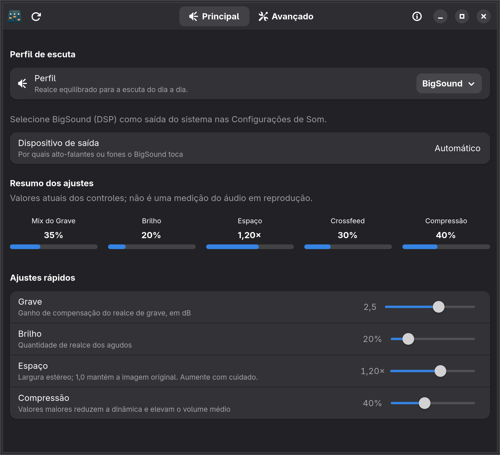
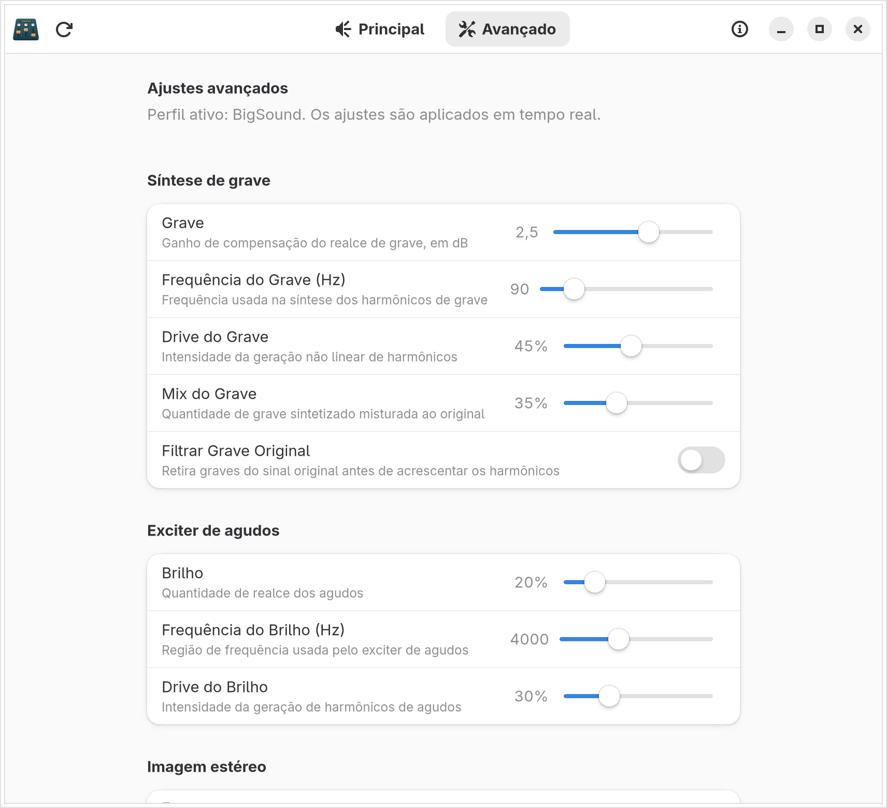
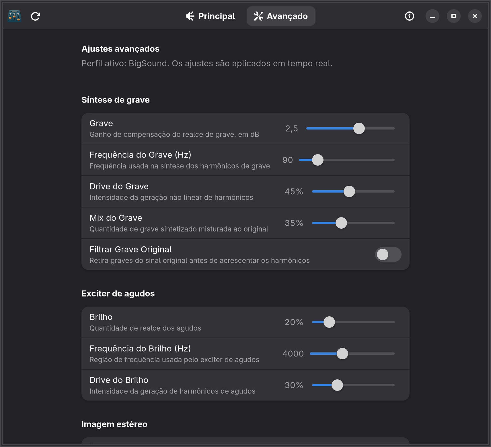
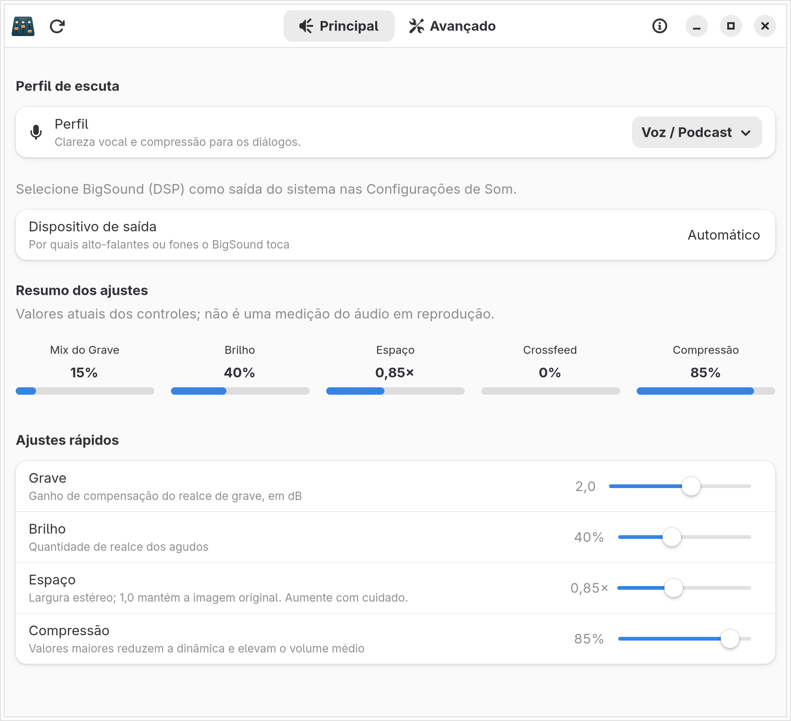
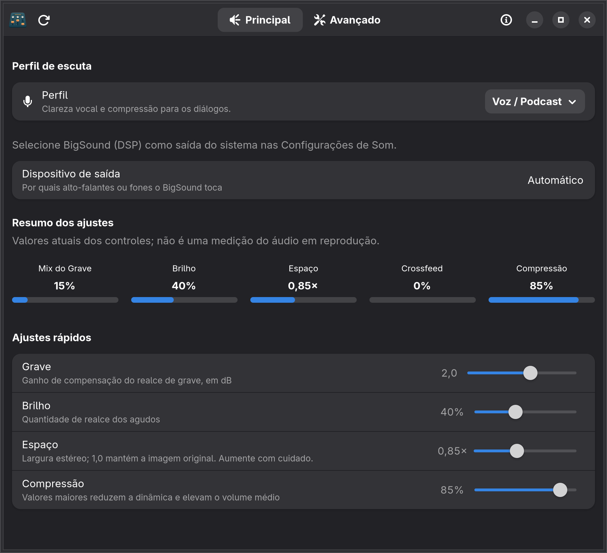

<p align="center">
  
</p>

# BigSound

Processamento de áudio para todo o sistema no BigCommunity/BigLinux, com
PipeWire, cinco módulos DSP em Rust e interface GTK4/libadwaita. Funciona
com navegadores, players, jogos e chamadas quando **BigSound (DSP)** está
selecionado como saída do sistema.

## Interface

### Principal

Escolha um perfil, confirme a saída e ajuste grave, brilho, espaço estéreo e
compressão. O perfil **BigSound** é o ponto de partida equilibrado.

**Tema claro**

<p align="center">
  <a href="assets/screenshots/main-light.png"></a>
</p>

**Tema escuro**

<p align="center">
  <a href="assets/screenshots/main-dark.png"></a>
</p>

### Avançado

Os **17 controles** ficam organizados por módulo: síntese de grave, exciter
de agudos, imagem estéreo, crossfeed e dinâmica/saída. Frequências, drive,
mix, atraso e teto de pico ficam disponíveis sem ocupar a tela principal.

**Tema claro**

<p align="center">
  <a href="assets/screenshots/advanced-light.png"></a>
</p>

**Tema escuro**

<p align="center">
  <a href="assets/screenshots/advanced-dark.png"></a>
</p>

### Um resumo visual para cada perfil

As barras acompanham os **valores reais dos controles** de mix de grave,
brilho, largura estéreo, crossfeed e compressão. A descrição e o símbolo do
perfil ajudam a identificar sua finalidade.

**Tema claro**

<p align="center">
  <a href="assets/screenshots/voice-light.png"></a>
</p>

**Tema escuro**

<p align="center">
  <a href="assets/screenshots/voice-dark.png"></a>
</p>

Esse resumo é um mapa dos ajustes, **não um analisador de espectro, medidor
de volume ou curva de resposta**. Percentuais indicam posições dos controles;
a largura estéreo aparece como fator: 1,0 é neutro. As barras são normalizadas
por suas faixas e não comparam grandezas físicas entre módulos.

As imagens são capturas reais nos temas claro e escuro, em português e resolução 2×,
numa sessão privada de teste. Nenhum dispositivo físico, áudio pessoal ou
desktop do usuário foi capturado. Clique nas imagens para ver os originais.

## Instalação

Requer Linux com PipeWire, GTK4, libadwaita ≥ 1.4, gettext e Rust/Cargo.

### Arch / BigCommunity

No checkout do projeto:

```bash
cd packaging
makepkg -si
systemctl --user enable --now filter-chain.service bigsound-daemon.service
```

A receita instala plugins LADSPA, daemon, interface, traduções, perfis e
integração. Depois abra **Configurações → Som → Saída** e selecione
**BigSound (DSP)**.

### Compilação e instalação local

```bash
./scripts/install.sh
```

O instalador compila com o lockfile e tenta instalar os plugins no usuário;
a alternativa em `/usr/lib/ladspa` requer sudo. Ele configura e inicia os
serviços de áudio do BigSound na sessão do usuário.

## Uso

1. Selecione **BigSound (DSP)** como saída do sistema.
2. Abra o aplicativo e escolha um perfil na aba **Principal**.
3. Deixe a saída física em **Automático** ou fixe seus alto-falantes/fones.
4. Use **Avançado** para parâmetros específicos.

O botão de restauração reaplica o **perfil selecionado inteiro**, incluindo
os controles avançados. `Ctrl+1` e `Ctrl+2` alternam as abas. Mudanças de
perfil pelo daemon/CLI e alterações de dispositivos são atualizadas na
interface. Escritas são serializadas fora da thread GTK; movimentos
consecutivos dos sliders são agrupados. Falhas são exibidas e os controles
voltam ao estado confirmado pelo daemon.

| Objetivo | Perfil |
|---|---|
| Uso geral | BigSound |
| Escuta de referência | Studio Reference |
| Realce contido | Audiophile |
| Alto-falantes pequenos | Laptop Speaker |
| Fones | Headphones |
| Fones com caráter de cinema | Headphones - Cinema |
| Bluetooth | Bluetooth |
| TV / monitor externo | HDMI / TV |
| Cinema estéreo | Atmos / Cinema |
| Jogos | Gaming |
| Voz e diálogos | Voice / Podcast |
| Realce intenso | Punchy |
| Grave intenso | Bass Heavy |
| Escuta discreta | Late Night |
| Gravações ao vivo | Live / Concert |

Esses nomes são os identificadores usados na CLI; a interface os traduz.
Há 15 perfis. Cinco perfis de dispositivo e o fallback permitem seleção
automática conforme a saída. Um dispositivo fixado evita que outra saída
de maior prioridade altere o destino escolhido.

```bash
bigsound show
bigsound profile list
bigsound profile apply "Voice / Podcast"
bigsound set bigclarity:mix 0.2
bigsound output list
bigsound output set <node.name>
bigsound output auto
bigsound profile save "Meu ajuste"
```

Perfis personalizados ficam em `~/.config/bigsound/profiles/`, ou no diretório
correspondente a `XDG_CONFIG_HOME`. Reabra a interface para incluir um perfil
criado externamente na lista. Reaplicar um perfil ou trocar automaticamente
de perfil substitui os ajustes manuais atuais; salve-os antes, se quiser
reutilizá-los.

## Cadeia de áudio


| Módulo | Processamento |
|---|---|
| BigBass | Síntese psicoacústica de harmônicos de grave |
| BigClarity | Exciter de agudos |
| BigSpace | Largura estéreo Mid/Side, com grave preservado no centro |
| BigCross | Crossfeed estéreo filtrado e atrasado para fones |
| BigLoud | Compressor estéreo vinculado e limiter de pico de amostra |

O áudio passa pelo filter-chain do PipeWire. O daemon gerencia parâmetros,
perfis e roteamento via D-Bus; não processa as amostras. Cada módulo é um
plugin LADSPA independente. O processamento DSP validado não aloca memória
durante processamento, atualização de parâmetros ou reset.

Compare efeitos em volume moderado e com loudness equivalente. O limiter
limita **picos de amostra**, sem garantia de true peak entre amostras. Os
estágios não lineares não usam oversampling e podem gerar aliasing. Largura
acima de 1,5 pode alterar a fase de material panoramizado. Crossfeed não é
decodificação surround; **Atmos / Cinema** é um preset estéreo, sem
decodificação Dolby Atmos ou renderização HRTF. Processamento de Bluetooth
não recupera informação descartada pelo codec.

## Desenvolvimento e validação

```bash
cargo build --release --locked
./scripts/validate.sh
BIGSOUND_TEST_SESSION=1 ./scripts/validate.sh
python3 scripts/test-gui.py --target target/release --theme light
python3 scripts/test-gui.py --target target/release --theme dark
python3 scripts/check-publication.py . --history
```

[VALIDATION.md](docs/VALIDATION.md) descreve verificações reproduzíveis.
[RELEASE-REVIEW.md](docs/RELEASE-REVIEW.md) registra evidências, limitações e
pendências de hardware/CI. Os testes privados usam D-Bus/PipeWire separados,
sem monitores de hardware ou conexão aos sockets de áudio do usuário.

Novas alterações são feitas em `dev-xathay` e revisadas por pull request para
`main`. Consulte [CONTRIBUTING.md](CONTRIBUTING.md).

Para uma receita portátil de distribuição, use
`scripts/render-release-pkgbuild.py` com uma fonte existente e SHA-256
verificado. `packaging/PKGBUILD` compila o checkout pai.

## Licença e autoria

GPL-3.0-or-later. Consulte [LICENSE](LICENSE).

Developed by BigCommunity Team.
Construído com Rust, PipeWire, GTK4, libadwaita e zbus.

O ícone combina um alto-falante estilizado, base grafite e acento ciano.
A assinatura Big foi reutilizada do ícone `big-audio-converter` do BigLinux;
a composição e a versão monocromática foram desenhadas para o BigSound.
Consulte [ICON-DESIGN.md](docs/ICON-DESIGN.md).
